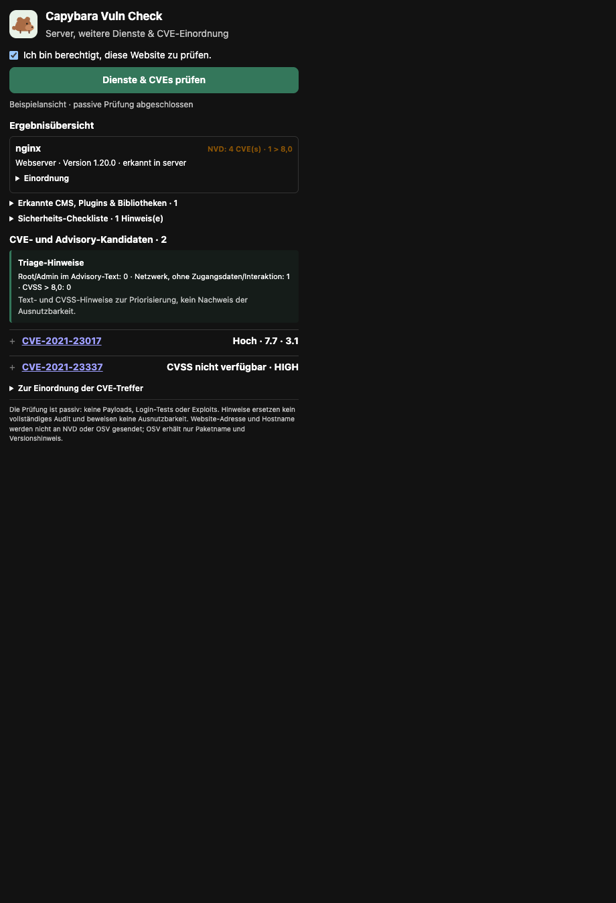

# Capybara Vuln Check

Eine Firefox-Erweiterung für passive Update- und Sicherheits-Hinweise auf
eigenen oder ausdrücklich autorisiert geprüften Websites. Nach Bestätigung
liest sie ausgewählte HTTP-Antwort-Header und bereits geladene Ressourcen.
Erkannte Produkt-/Versions-Kombinationen werden über CPE mit der NVD
abgeglichen. Ergänzend gibt es eine kleine, lokal gepflegte Advisory-Liste für
WordPress-Core, sichtbare WordPress-Plugins, Joomla JCE und PHP, weil NVD-
Einträge für manche Plugins keine maschinenlesbaren CPE-Konfigurationen haben.

Angezeigt werden CVE-Kandidaten samt Status, CVSS und einer nachvollziehbaren
Einordnung. Werte über 8,0 werden hervorgehoben. Die Erweiterung bewertet
passiv CSP, HSTS, Clickjacking-/MIME-Schutz, Browser-Policies, Cookie-
Attribute, Mixed Content, Passwortformulare sowie Drittanbieter-Skripte,
Stylesheets, Frames und Formularziele. Es werden nur bereits geladene Ressourcen
betrachtet; die Erweiterung erzeugt keine zusätzlichen Verbindungen zur Website.
Bei CVEs fasst eine Triage die im Advisory-Text erwähnten Root-/Admin-Rechte
sowie CVSS-Angriffsvektor, benötigte Privilegien und Nutzerinteraktion zusammen.
Diese Metadaten helfen bei der Priorisierung, bestätigen aber weder Ausnutzbarkeit
noch Root-Zugriff auf die erkannte Website.

## Projektstruktur

<p align="center">
  
</p>

Die CVE- und Versionsangaben in der Beispielansicht sind Beispieldaten.

```text
manifest.json             Firefox-Einstiegspunkt
assets/icons/             Erweiterungssymbole
src/
  background.js             Header-Erfassung beim Seitenreload
  popup.html                Popup-Einstiegspunkt
  popup/scripts/            Erkennung, NVD, Posture, UI und Orchestrierung
  styles/                   Popup-Styles
tests/                      Offline-Tests ohne Netzwerkzugriff
```

Die Erweiterung hat absichtlich keinen Build-Schritt: Firefox lädt die Dateien
direkt über `manifest.json` und `src/popup.html`.

## Installation zum Testen

1. Öffne `about:debugging` in Firefox.
2. Wähle **Dieser Firefox** und **Temporäres Add-on laden**.
3. Wähle die Datei `manifest.json` aus diesem Verzeichnis.
4. Öffne eine eigene oder ausdrücklich autorisierte Website und klicke auf das
   Capybara-Symbol.
5. Bestätige im Popup, dass du zur Prüfung berechtigt bist, und starte den Scan.
   Beim ersten Scan bittet Firefox zusätzlich um Zugriff auf den Host der
   geöffneten Seite und die optionale Berechtigung „Scripting“ für die passive
   Analyse bereits geladener Seiteninhalte. Bei HTTPS fragt Firefox außerdem
   optional nach der Berechtigung zum Lesen der TLS-Verbindungsmetadaten. Die
   Seite wird zur Erfassung der Hauptseiten-Antwort einmal neu geladen.

Nach Änderungen an `manifest.json` muss das Add-on unter `about:debugging`
entfernt und mit **Temporäres Add-on laden** erneut geladen werden.

## Grenzen und Datenschutz

- Es werden nur ausgewählte Antwort-Header der Hauptseite und URLs bereits
  geladener Seitenressourcen ausgewertet. Das Add-on crawlt keine Seiten und
  führt keine aktiven Schwachstellenprüfungen durch.
- Neben Server-/Runtime- und CMS-Hinweisen werden Namen und Versionshinweise
  ausgewählter JavaScript-Bibliotheken (jQuery, Bootstrap, Lodash, AngularJS)
  nur aus bereits geladenen Asset-URLs erkannt. Dafür werden keine weiteren
  Seitenressourcen abgerufen. Ein CPE-Abgleich erfolgt nur für Komponenten mit
  konfiguriertem Produktprofil; Dateinamen und `ver`-Parameter sind schwache
  Hinweise und kein Beweis der installierten Version.
- Für erkannte npm-Bibliotheken mit exakter dreiteiliger Versionsnummer fragt
  das Add-on zusätzlich die OSV-Datenbank ab. An OSV werden ausschließlich
  Paketname, npm-Ökosystem und Versionsnummer gesendet – keine Website-Adresse
  oder Hostname. OSV-Advisories werden als Kandidaten mit Quelle und Alias-IDs
  angezeigt; ein fehlender CVSS-Score wird nicht als niedriger Score gewertet.
- Die passive Checkliste markiert Formularfelder und bereits vorhandene URL-
  Parameter mit Datei-/Pfadbezug zur manuellen Prüfung auf Path Traversal. Sie
  sendet keine Testwerte und kann keine serverseitigen Schwachstellen bestätigen.
- Cookie-Werte werden nicht gespeichert oder angezeigt; ausgewertet werden
  nur Anzahl und Secure-/HttpOnly-/SameSite-Attribute sowie die formalen
  Anforderungen an `__Host-`/`__Secure-`-Präfixe der Cookies im
  Hauptseiten-Response. Header-Befunde sind Hinweise und müssen zur Anwendung
  passen; insbesondere CSP- und Browser-Policies können Funktionen brechen.
- CSP-Hinweise umfassen unter anderem `default-src`, unsichere Script-Ausnahmen,
  `object-src` und `base-uri`. Sie sind keine automatische Konfigurations-
  empfehlung; Richtlinien müssen vor Durchsetzung an die Website angepasst und
  getestet werden.
- Der Header-Posture-Scan prüft zusätzlich HSTS-Direktiven und Preload-
  Voraussetzungen, die wirksame Referrer-Policy sowie Wildcard-Freigaben
  sensibler Funktionen in Permissions-Policy. Das sind Konfigurationshinweise,
  keine automatische Bewertung der Anwendungsanforderungen; Subdomain- und
  Browser-Kompatibilität muss vor Änderungen geprüft werden.
- WordPress-Plugin-Namen stammen aus öffentlichen Asset-Pfaden. Ein `ver`-
  Parameter ist nur ein schwacher Versionshinweis und kann eine Asset-Version
  statt der installierten Plugin-Version bezeichnen. Treffer aus diesem Wert
  sind deshalb nur Update-Hinweise; die Installation im CMS oder Deployment
  muss vor einer Entscheidung geprüft werden.
- Der ergänzende Advisory-Katalog umfasst derzeit:
  - WordPress-Plugins: [CVE-2020-36847](https://nvd.nist.gov/vuln/detail/CVE-2020-36847),
    [CVE-2025-12057](https://nvd.nist.gov/vuln/detail/CVE-2025-12057),
    [CVE-2025-13486](https://nvd.nist.gov/vuln/detail/CVE-2025-13486) und
    [CVE-2025-6389](https://nvd.nist.gov/vuln/detail/CVE-2025-6389).
  - WordPress-Core: [CVE-2026-60137](https://nvd.nist.gov/vuln/detail/CVE-2026-60137)
    und [CVE-2026-63030](https://nvd.nist.gov/vuln/detail/CVE-2026-63030).
  - Joomla JCE: [CVE-2026-48907](https://nvd.nist.gov/vuln/detail/CVE-2026-48907).
  - PHP: [CVE-2026-109618](https://nvd.nist.gov/vuln/detail/CVE-2026-109618)
    und [CVE-2026-109619](https://nvd.nist.gov/vuln/detail/CVE-2026-109619).

  Versionen werden nur dann als im erfassten Bereich markiert, wenn sie zu den
  dokumentierten Versionsbereichen passen; unbekannte Plugin-Versionen
  verlangen eine manuelle Prüfung. Der Katalog ersetzt keine regelmäßige
  Aktualisierung und ist keine vollständige CVE-Datenbank.
- CVE-2025-34085 ist von der CNA zurückgezogen/abgelehnt und als Duplikat von
  CVE-2020-36847 gekennzeichnet; die zurückgezogene ID wird nicht als aktive
  Schwachstelle ausgegeben.
- Die NVD-Abfrage verwendet das erkannte Produkt und die Version als CPE.
  Ergebnisse sind Hinweise, kein Beweis, dass das konkrete System verwundbar
  ist; ebenso beweist ein leerer Befund keine Sicherheit. CVSS bewertet die
  Schwachstelle allgemein, nicht die tatsächliche Konfiguration der Website.
  NVD-CPE-Datensätze können bei Herstellernamen und Produktzuordnung variieren.
- Die Dienstübersicht zeigt die Zahl der zugeordneten NVD-CVEs und wie viele
  davon CVSS > 8,0 haben. CVE-Kandidaten werden nicht mehr allein wegen eines
  niedrigeren Scores ausgeblendet. Hinweise und Beschreibungen sind aufklappbar.
- Pro Produkt werden höchstens die ersten 100 NVD-Ergebnisse ausgewertet.
- NVD-Anfragen laufen nacheinander mit Abstand, um die öffentliche API nicht
  durch parallele Abfragen zu überlasten; mehrere erkannte Produkte können
  deshalb etwas länger brauchen.
- Bei Distributionsversionen wie Debian können Fixes zurückportiert sein.
  Ein Upstream-Versionsvergleich kann dann einen falschen Alarm auslösen;
  Distribution-Advisories bleiben maßgeblich.
- An die NVD wird nur das CPE gesendet, nicht die Seiten-URL oder der Hostname.
- Für HTTPS kann Firefox nach Zustimmung TLS-Metadaten des ohnehin geladenen
  Hauptseiten-Requests bereitstellen: ausgehandelte Protokollversion und
  Cipher-Suite sowie ausgewählte Eigenschaften des Serverzertifikats. Es wird
  nur das Leaf-Zertifikat ausgewertet; keine Zertifikatskette angefordert.
  Firefox’ TLS-Bewertung, veraltete Protokolle, Namensabweichungen, Gültigkeit
  und Vertrauensstatus werden als Hinweise dargestellt. Die TLS-Metadaten
  verlassen den Browser nicht; JSON-/CSV-Exporte enthalten sie dagegen.
  Firefox liefert bei fehlgeschlagenem TLS-Handshake möglicherweise kein
  `onHeadersReceived`-Ereignis, daher kann der Scan solche Verbindungsfehler
  nicht zuverlässig klassifizieren.
- Die zusätzliche API-Berechtigung `webRequestBlocking` ist optional und wird
  nur für den TLS-Scan angefordert. Der Listener ist während des Scans auf den
  aktiven Tab und dessen Hauptseiten-Request beschränkt; Antwortdaten werden
  nicht verändert. Wird die Berechtigung abgelehnt, laufen die übrigen
  passiven Prüfungen weiter und der TLS-Scan wird als nicht verfügbar markiert.
- Die optionale Berechtigung `scripting` wird für die passive Analyse bereits
  geladener Seiteninhalte erst beim Start eines Scans angefordert. Sie wird
  über `browser.scripting.executeScript` gezielt auf den aktiven Tab angewandt;
  es werden keine zusätzlichen Requests ausgelöst.
- Es werden keine Ports gescannt, keine weiteren Endpunkte abgefragt und keine
  Exploits ausgeführt.
- NVD kann Anfragen begrenzen oder vorübergehend nicht erreichbar sein.

## Evidenz, Threat Intelligence und Verlauf

- CVE-Befunde enthalten Quelle, Erkennungsmethode, Beobachtungszeitpunkt,
  Erkennungsvertrauen und technische Evidenz. Versionsangaben aus Server-Bannern,
  Asset-URLs und SBOMs bleiben ausdrücklich unbestätigte Hinweise; auch ein
  NVD-CPE-Treffer beweist nicht, dass die Website verwundbar ist.
- CVE-Kandidaten werden mit NVD und OSV abgeglichen. CVE-IDs werden zusätzlich
  gegen CISA KEV und FIRST EPSS angereichert. Ein fehlender KEV-Eintrag wird
  nur dann als „nicht gelistet“ ausgewiesen, wenn der Feed erfolgreich geladen
  wurde; ein Quellenfehler bleibt davon unterscheidbar. Der KEV-Feed wird
  höchstens 24 Stunden lokal zwischengespeichert.
- Die Priorität ist eine begründete Triage-Einstufung aus CVSS, EPSS,
  KEV-Status, Netzwerk-Angriffsvektor und Zuordnungsqualität. Sie ist kein
  Ausnutzbarkeitsnachweis und kein frei interpretierbarer Gesamtscore.
- Zur Verringerung offensichtlicher Fehlalarme werden NVD-Einträge mit Status
  „Rejected“ und zurückgezogene OSV-Advisories herausgefiltert; doppelte
  CVE-Ergebnisse desselben Produkts werden zusammengeführt. Ein Upstream-
  Versionsvergleich kann zurückportierte Distributions-Patches nicht
  zuverlässig erkennen. Die Erweiterung kann Backports deshalb nicht
  bestätigen; Distributions-Advisories und tatsächlicher Patchstand müssen
  separat geprüft werden.
- Importiert werden CycloneDX-JSON- und SPDX-JSON-Dateien bis 5 MiB und
  höchstens 20.000 Komponenten. SBOM-Versionen werden als deklarierte,
  deployment-unbestätigte Angaben behandelt. Für unterstützte Paketkoordinaten
  sendet die Erweiterung Name, Ökosystem und Version an OSV; die SBOM-Datei
  selbst, Hostname und Website-Adresse werden nicht hochgeladen.
- Der lokale Verlauf speichert pro Website-Ursprung bis zu 30 Snapshots in
  Firefox `storage.local`, einschließlich erkannter Komponenten, CVE-IDs und
  ausgewählter Security-Header. Er wird nicht synchronisiert und kann im Popup
  gelöscht werden.
- Berichte können als JSON oder CSV exportiert werden. „Drucken / PDF“ öffnet
  den Druckdialog des Browsers; dort kann „Als PDF speichern“ gewählt werden.
  Es wird kein eigenständiges PDF-Format erzeugt.
- Der lokale Scanverlauf vergleicht zusätzlich TLS-Protokoll, Cipher-Suite und
  den SHA-256-Fingerprint des Serverzertifikats; daraus werden keine externen
  Abfragen ausgelöst.

## Entwicklung und Tests

Die Tests laufen offline mit Node.js und greifen nicht auf Websites oder die
NVD zu:

```sh
npm test
```
